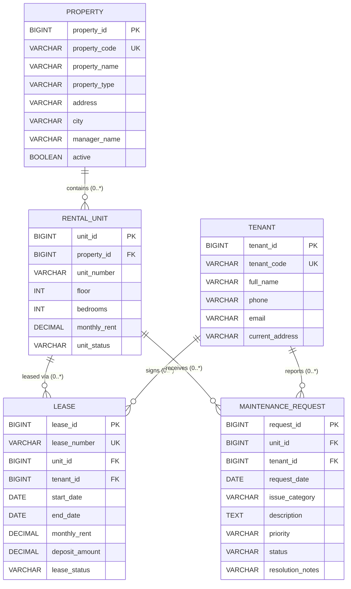

# Property Rental and Lease Administration System

**Project Title:** Property Rental and Lease Administration System  
**Domain:** Real Estate / Property Management  
**Tech Stack:** Angular (Bootstrap 5) | Spring Boot (Java 17, Spring Data JPA, Bean Validation) | MySQL 8.0 (InnoDB)

---

## Project Structure

```text
property-rental-system/
├── database/
│   ├── schema.sql                # MySQL InnoDB schema (5 entities + PK/FK/UNIQUE constraints)
│   ├── seed.sql                  # Sample data (properties, units, tenants, leases, maintenance)
│   └── verify_screenshot8.sql    # Verification queries (SHOW TABLES, FKs, joined rows)
├── backend/                      # Spring Boot REST API (includes Maven Wrapper mvnw / mvnw.cmd)
├── frontend/                     # Angular SPA calling Spring Boot REST APIs
└── README.md
```

---

## Prerequisites

- **Java JDK 17+** (`JAVA_HOME` configured)
- **Node.js 20+** and **npm**
- **MySQL Server 8.0** (and MySQL Workbench, optional)
- *(No global Maven or Angular CLI installation required — the project includes the Maven Wrapper `mvnw.cmd` / `./mvnw` and local Angular CLI via `npm`.)*

---

## How to Run the Project

### Step 1: Set Up the MySQL Database

1. Ensure your MySQL 8.0 service (`MySQL80` on Windows) is running.
2. Execute `database/schema.sql` to create `property_rental_db` and all 5 InnoDB tables.
3. Execute `database/seed.sql` to insert initial sample records.

Using MySQL CLI (or open and run both files in MySQL Workbench):
```powershell
mysql -u root -p < database/schema.sql
mysql -u root -p < database/seed.sql
```

### Step 2: Run the Spring Boot Backend

Database credentials are **not** stored in the repository. Provide your local MySQL password in one of two ways:

- **Option A — Environment variable (recommended):**
  ```powershell
  cd backend
  $env:DB_PASSWORD="your_mysql_password"
  .\mvnw.cmd spring-boot:run
  ```
  *(On macOS/Linux: `DB_PASSWORD="your_mysql_password" ./mvnw spring-boot:run`)*

- **Option B — Local ignored properties file:**
  Create `backend/src/main/resources/application-local.properties` (already ignored by `.gitignore`):
  ```properties
  DB_PASSWORD=your_mysql_password
  ```
  Then start the backend:
  ```powershell
  cd backend
  .\mvnw.cmd spring-boot:run
  ```
  *(Or import `backend/` into Eclipse / IntelliJ as an Existing Maven Project and run `PropertyRentalApplication.java`.)*

The Spring Boot API (embedded Apache Tomcat) starts at **http://localhost:8080**.

### Step 3: Run the Angular Frontend

Open a second terminal:
```powershell
cd frontend
npm install
npm start
```
Open **http://localhost:4200** in your browser.

---

## ER Diagram



---

## REST API Endpoint Summary

| Resource | Endpoints | Key Business Rules |
|---|---|---|
| **Properties** | `GET/POST /api/properties`, `GET/PUT/DELETE /api/properties/{id}` | Unique `propertyCode`; blocks deleting property with rental units (`409 Conflict`) |
| **Rental Units** | `GET/POST /api/units`, `GET/PUT/DELETE /api/units/{id}` | Unique `(propertyId, unitNumber)`; blocks deleting unit with lease or maintenance history (`409 Conflict`) |
| **Tenants** | `GET/POST /api/tenants`, `GET/PUT/DELETE /api/tenants/{id}` | Unique `tenantCode`; blocks deleting tenant with lease or maintenance history (`409 Conflict`) |
| **Leases** | `GET/POST /api/leases`, `GET/PUT/DELETE /api/leases/{id}` | Rejects overlapping `Active` leases for same unit (`409 Conflict`); auto-syncs unit status (`Occupied` / `Vacant`); validates `endDate >= startDate` (`400 Bad Request`) |
| **Maintenance Requests** | `GET/POST /api/maintenance-requests`, `GET/PUT/DELETE /api/maintenance-requests/{id}` | Tracks workflow `Open` -> `Assigned` -> `In Progress` -> `Resolved` with priority and resolution notes |

---

## Verification Scenarios

1. Create a property, rental units, and register a tenant.
2. Create an `Active` lease on a `Vacant` unit and verify the unit automatically updates to `Occupied`.
3. Attempt to create an overlapping `Active` lease for the same unit and verify `409 Conflict` rejection.
4. Create a maintenance request (`Open`) and progress it through `Assigned` -> `In Progress` -> `Resolved`.
5. Verify occupancy %, vacant units, and upcoming lease-expiry alerts on `/dashboard`.
